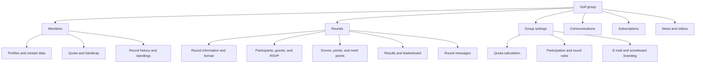
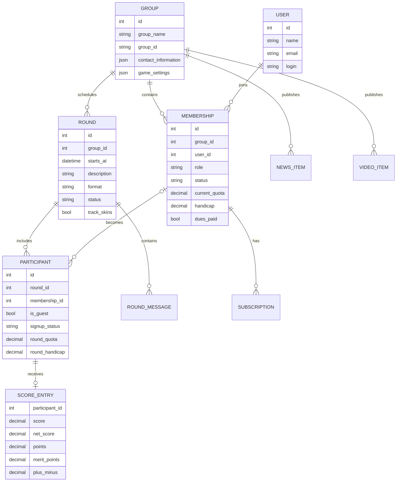
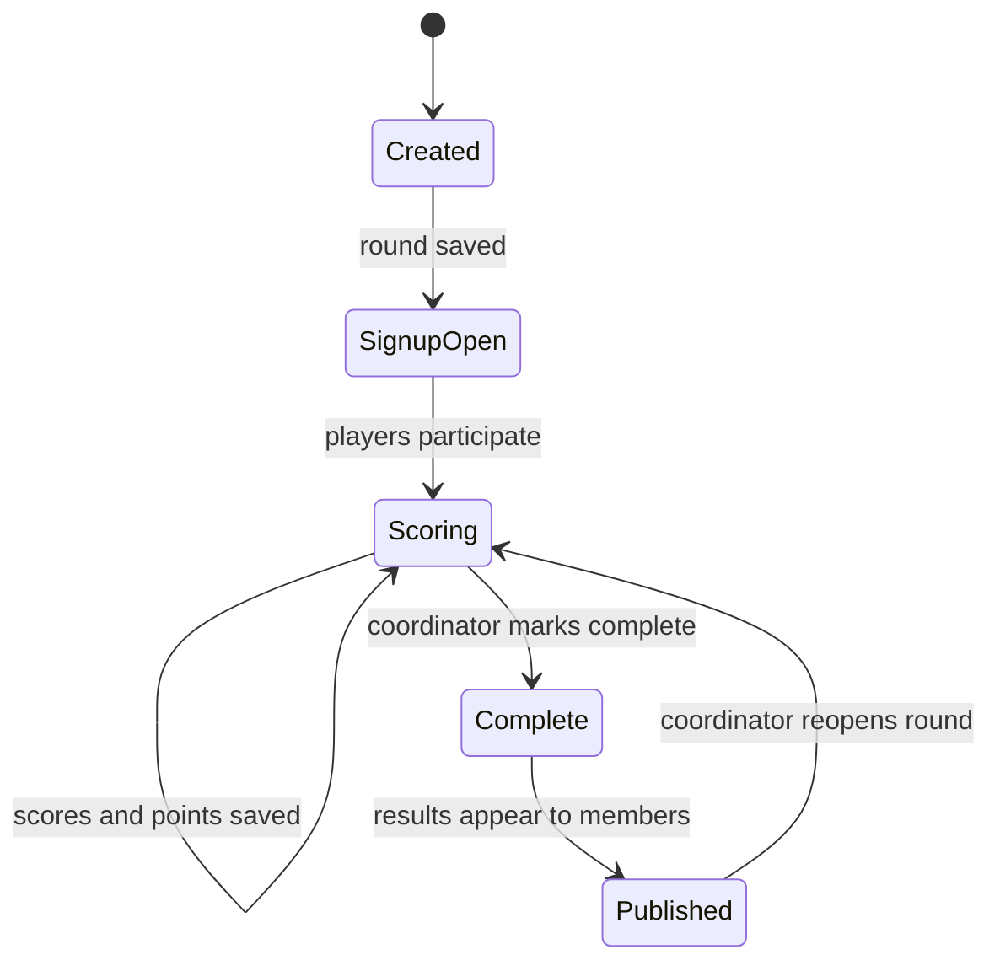
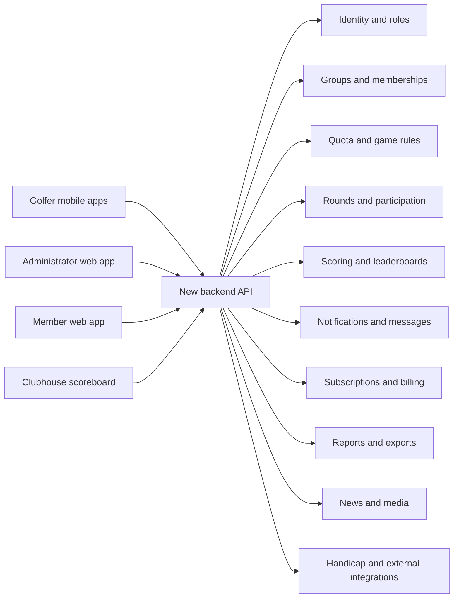

# How the GreenRoster system works

This document explains the current GreenRoster product as a system: its users, data, modules, business rules, and end-to-end workflows. It is intended to help plan a replacement backend, mobile app, and web application. It describes the product behavior rather than evaluating the old interface.

## 1. What GreenRoster does

GreenRoster manages recurring golf points games for a group of golfers.

The system handles five connected jobs:

1. Maintain the group and its members.
2. Calculate a fair quota for every member.
3. Schedule rounds and collect participation responses.
4. Record scores and points, calculate plus/minus, and determine winners.
5. Publish results, standings, messages, and group information.

It also includes communication, subscriptions, printable reports, news, videos, and a clubhouse scoreboard.

The central concept is a **group**. A group has members, settings, rounds, coordinators, an administrator, and its own history.

## 2. Golf points-game terminology

### Group

A club or recurring collection of golfers using GreenRoster together. A group does not have to belong to one golf course.

### Member

A golfer permanently stored in the group’s membership list. A member has contact information, a handicap, a current quota, round history, membership status, and an individual login.

### Guest

A golfer added to one specific round without becoming a permanent group member. A guest has a name, e-mail address, quota, and handicap for that round. Guests do not appear in group member totals or long-term member standings.

### Round or DogFight

A scheduled golf event. A round contains its date, time, description, notes, format, participants, signup statuses, scores, points, and results.

### Points

The points a golfer earns during a round. The precise hole-by-hole point rules are not configured in the screens inspected; the system accepts the final points total and uses it for quota and winner calculations.

### Quota

A target number of points for a golfer. A stronger player normally has a higher quota.

### Plus/minus

The difference between the player’s points and the quota used for that round:

`Plus/Minus = Round Points − Round Quota`

Example: a player with a quota of 24 who scores 27 points finishes at +3.

### Merit points

Separate ranking points used for the group’s Order of Merit. Merit points are not the same as golf points or plus/minus.

### Signup status

The administration screens use:

- `P` — participating / playing
- `N` — not participating / not playing

Only participating players can have scores, points, and merit points entered.

### Complete round

A round becomes complete after scoring is finished. Completion publishes the results and locks score editing. A coordinator can reopen the round by marking it incomplete again.

## 3. Users and access levels

GreenRoster has several access modes.

| Access type             | Purpose                           | Main capabilities                                                                   |
| ----------------------- | --------------------------------- | ----------------------------------------------------------------------------------- |
| Shared group login      | General group access              | View group information, members, rounds, results, standings, news, and messages     |
| Individual member login | Personal golfer access            | Update the golfer’s own profile, RSVP for rounds, and use member/mobile functions   |
| Coordinator             | Day-to-day group operations       | Manage members, rounds, scores, news, and videos                                    |
| Administrator           | Group ownership and configuration | All coordinator functions plus group information, settings, and password management |
| Guest                   | One-round participation           | Participate in a single round without becoming a member                             |

### Shared group login versus individual member login

The group has a shared Group ID and Group Password. Members can use those credentials to view group information.

Actions belonging to one person—such as changing a personal profile or responding to a round invitation—require the member’s unique individual login.

### Coordinator versus administrator

A coordinator runs the golf operation:

- members;
- rounds;
- participants;
- scores;
- news;
- videos.

The administrator owns group-level configuration:

- group identity and contact information;
- quota and game settings;
- shared group password;
- administrator password;
- member subscription status.

## 4. High-level product structure

## 5. Core data model

The current product can be understood with the following logical entities.

This is a conceptual model, not the verified physical database schema.

### Important distinction: member versus participant

A **member** belongs to the group over time.

A **participant** belongs to one round.

When a member is assigned to a round, the round needs a snapshot of information such as:

- signup status;
- quota for that round;
- handicap for that round;
- score;
- points;
- merit points;
- plus/minus;
- status-change time.

This distinction is important for the replacement system. If a member’s current quota changes after a round, the historical round must still show the quota that was used when that round was played.

A guest is a participant without a permanent group membership.

## 6. Group creation and initial setup

The current setup process creates two levels of group credentials:

1. Group ID and Group Password for shared access.
2. Administrator Password for management access.

The registration also records:

- group name;
- optional golf-course information;
- optional golf-professional information;
- administrator name and contact details.

After registration, the administrator needs to perform three setup jobs:

1. Configure group and quota rules.
2. Add members.
3. Schedule the first round.

## 7. Member management

The permanent member record is organized into six sections.

### Personal

- first and last name;
- spouse first and last name.

### Contact

- primary e-mail;
- secondary e-mail;
- home phone;
- work phone;
- mobile phone;
- mobile provider;
- permission to receive text messages;
- visibility setting for individual contact fields.

The primary e-mail must be unique.

### Address

- street address;
- city;
- state/region;
- postal code;
- country;
- whether the address is visible to other members.

### Golfer information

- Handicap ID;
- handicap value;
- tee location: Pro, Back, Middle, or Front;
- whether the golfer participates in skins.

### Membership information

- active or inactive status;
- initial quota;
- whether to keep using the initial quota;
- dues-paid flag;
- coordinator role.

Inactive members do not receive group communications and cannot sign up for rounds.

### Initial round history

The coordinator can enter up to 20 previous point totals for a new member. This gives the quota calculation enough history without creating 20 historical rounds individually.

### Other member-management operations

- search and alphabetical filtering;
- mass updates;
- handicap import;
- bulk e-mail;
- bulk text messaging;
- printing member, contact, and round-history reports.

## 8. Quota calculation

The group chooses one quota method.

### Method A: moving average of previous rounds

The member’s current quota is the average of points from a configurable number of previous rounds.

The available history window is 4–20 rounds. The current default is 10.

Conceptually:

`Current Quota = Average(points from the previous N eligible rounds)`

### Method B: best 10 of the last 20

The system looks at the member’s last 20 point totals, selects the best 10, and averages them.

Conceptually:

`Current Quota = Average(best 10 point totals from last 20 rounds)`

### Method C: adjustment based on previous plus/minus

The current quota is increased or decreased according to the player’s plus/minus in the previous round. The administrator configures the adjustment associated with each plus/minus range.

Conceptually:

`New Quota = Previous Quota + Adjustment(previous Plus/Minus)`

### Initial quota

A new golfer can be assigned an initial quota. The `Use Initial Quota` flag can freeze that value until enough history exists.

For the adjustment-based method, the product instructions say the initial quota should remain enabled for each member.

### Rounding

The group can calculate quotas with 0, 1, or 2 decimal places.

### Historical reset date

The administrator can choose a date after which rounds count toward:

- number of rounds played;
- Order of Merit points.

Older data is retained but excluded from the current standings calculation.

## 9. Round structure

A round contains two groups of settings.

### General information

- date;
- time;
- description;
- notes, up to 500 characters;
- whether notes are visible to players;
- optional round URL;
- whether to notify and allow signup by e-mail;
- whether to notify and allow signup by text message.

### Round format

Observed format controls include:

- Individual Net — winner has the best plus/minus;
- Individual Gross — winner has the most points;
- Teams;
- Require Entry;
- Track Skins.

The product instructions say team rounds can use two-person or four-person teams and net or gross scoring.

A group setting also enables management of non-points rounds such as best-ball or scramble tournaments.

## 10. Round lifecycle

The current product does not expose a separate draft state. A saved round immediately exists in the group.

### Created / incomplete

- Round information and format can be edited.
- Members can be assigned.
- Guests can be added.
- Signup statuses can change.
- Scores and points can be entered for participating players.

### Complete

- The system publishes results.
- Score fields become read-only.
- Participation points are applied if configured.
- The round appears in Recent Rounds with its winners.

### Reopened

The coordinator can mark the round incomplete again to correct it. The product states that automatically applied participation points are removed when the round is reopened.

## 11. Participant assignment and RSVP

Active members are the normal source of round participants. Inactive members are not automatically assigned to new rounds, but a coordinator can assign them manually after reactivation.

Each round participant has:

- signup status;
- signup-status change timestamp;
- quota for the round;
- optional score fields.

Members can respond through:

- their individual account;
- links in a round signup e-mail;
- links or actions associated with text-message invitations;
- the mobile experience.

The group setting `Allow members to sign up guests for events` controls whether ordinary members can add guests themselves.

Coordinators can always add a guest while managing the round.

## 12. Scoring and winner calculation

The round-management grid contains one row per participant.

Observed score fields:

- quota;
- gross score;
- net score;
- points;
- merit points;
- plus/minus;
- signup status.

Only players with status `P` can receive scoring values.

When the coordinator saves points, the system calculates:

`Plus/Minus = Points − Round Quota`

### Example

| Player    | Round quota | Points | Plus/minus |
| --------- | ----------: | -----: | ---------: |
| TestGamma |          28 |     32 |         +4 |
| TestAlpha |          24 |     27 |         +3 |
| TestDelta |          22 |     22 |          0 |
| TestBeta  |          18 |     17 |         −1 |

For an Individual Net round, the order above is also the leaderboard order. TestGamma wins with +4.

For Individual Gross, the player with the most points wins regardless of quota.

Merit points can be recorded separately and later contribute to the Order of Merit.

## 13. Results and statistics

### Round results

After completion, members can see:

- player name;
- quota used for the round;
- score;
- points;
- plus/minus;
- merit points;
- participation status and timestamp.

The group home shows recent completed rounds and winners. A full-results link opens the complete leaderboard.

### Member statistics

The member directory and standings use:

- current quota;
- recent point history;
- total merit points;
- number of rounds played;
- most recent round;
- Order of Merit ranking.

Guests participate in round results but do not become permanent members and do not populate the long-term member standings.

## 14. Communications

The system has several communication paths.

### Member e-mail and text

Coordinators can select members and send:

- group e-mail;
- group text messages.

### Round invitations

When creating or editing a round, a coordinator can enable:

- e-mail invitations and RSVP links;
- text-message invitations and RSVP actions.

### News

Coordinators can create dated news items with a subject and content. News appears on group and member home pages. A news item can also be e-mailed to all active members.

### Round messages

Every round has a message board. Posts are limited to 300 characters. Coordinators can remove messages.

### Branding

The administrator can configure:

- custom e-mail header image;
- custom e-mail footer image;
- link attached to the footer image;
- footer click history;
- scoreboard header image;
- up to three scoreboard footer banners.

## 15. Mobile experience

The existing mobile product is a mobile website rather than a native app.

Based on the desktop help and available controls, its intended functions are:

- login;
- view upcoming rounds;
- RSVP;
- add a guest when allowed;
- enter scores, points, and skins;
- view other scores;
- view the live scoreboard.

The desktop coordinator page contains an action described as:

`BETA: Import scores and points from the mobile app!`

The exact synchronization model needs confirmation. There are two possible interpretations:

1. Mobile scores are written to a temporary mobile data area and imported into the main round by a coordinator.
2. The import is a legacy fallback, while other views already read the same live data.

This distinction is important when designing the replacement backend.

## 16. Clubhouse scoreboard

GreenRoster advertises a scrolling real-time scoreboard that can be cast to a clubhouse television.

The system allows the group to customize it with:

- a header image;
- three footer/sponsor banners.

The scoreboard appears to be a separate presentation of round results. Its exact URL, refresh model, authentication, and interaction with incomplete rounds were not exposed in the inspected screens.

For the replacement, the scoreboard should be considered a fourth client surface alongside:

1. golfer mobile app;
2. administrator web portal;
3. member web portal;
4. clubhouse scoreboard.

## 17. Subscriptions and billing

GreenRoster offers a 30-day group trial.

After the trial, each permanent member requires an annual subscription. The public product information states a price of $10 per member per year.

The group-information screen tracks:

- total members;
- active members;
- inactive members;
- members expired or expiring within 10 days.

The administrator can purchase subscriptions for expired members.

The round-management instructions state that after the trial expires, a subscription must be purchased for a new member before that member can be assigned to a round.

Guests are round-scoped and do not appear in permanent member totals.

## 18. Reports and exports

The product supports several printable outputs:

- member list;
- member contact information;
- member quota and round history;
- round participant list;
- round points worksheet;
- team list;
- group standings;
- points-game score pad PDF.

These reports represent operational use cases that the replacement should preserve even if the exact print layouts change.

## 19. Content features

### Group news

Used for announcements displayed on group and member home pages.

### Group videos

Coordinators can upload:

- a video;
- a thumbnail;
- a subject;
- a display date;
- a number of display days;
- a default-video flag.

The replacement project should confirm whether uploaded video is still a required business feature or can be replaced by linked/embedded media.

## 20. Current screen organization

### Member/shared web portal

- Home
  - Upcoming Rounds
  - Recent Rounds
  - Current Standings
  - News
- Members
- Rounds
  - Players / RSVP
  - Completed results
  - Messages

### Coordinator web portal

- Manage Members
- Manage Rounds
- Manage News
- Manage Videos

### Administrator web portal

- View Group Information
- Manage Group Settings
- Change Group Password
- Change Admin Password

## 21. Suggested organization of the replacement system

The replacement should preserve the business concepts while reorganizing them into clear backend modules.

### Backend modules

1. **Identity and roles** — accounts, login, group membership, member/coordinator/admin permissions.
2. **Groups** — group profile, course/pro information, branding, configuration.
3. **Members** — golfer profile, contact preferences, handicap, quota, status, history.
4. **Quota engine** — algorithms, initial quota, rounding, history windows, quota snapshots.
5. **Rounds** — scheduling, formats, notes, participants, RSVP, guests, completion state.
6. **Scoring** — score entry, points, skins, teams, plus/minus, merit points, winners.
7. **Live updates** — score synchronization and leaderboard subscriptions.
8. **Communications** — push, e-mail, optional SMS, announcements, round messages.
9. **Billing** — member entitlement, trial, annual subscriptions, renewals, receipts.
10. **Reports** — standings, round results, member history, print/export.
11. **Content** — news and any retained media features.
12. **Integrations** — handicap service, payment processor, notification providers.

### Mobile app responsibilities

- upcoming rounds;
- RSVP and guests;
- round details;
- on-course score entry;
- live leaderboard;
- round messages;
- completed results;
- personal quota and history;
- profile and notification preferences.

### Administrator web responsibilities

- group setup;
- members and roles;
- round setup;
- participant management;
- live round operations;
- scoring corrections and completion;
- quota/game settings;
- communications;
- subscriptions;
- reports and branding.

## 22. End-to-end example

The complete system flow can be understood through one round.

1. The administrator creates the group and chooses a quota method.
2. A coordinator adds four members and provides initial quotas or history.
3. The coordinator creates a Saturday round using Individual Net format.
4. The system assigns active members to the round.
5. Invitations are sent.
6. Members choose Playing or Not Playing.
7. A member adds a guest if the group permits it.
8. During the round, scores and points are entered from mobile devices.
9. The backend calculates plus/minus using each participant’s round quota.
10. The live leaderboard orders players by plus/minus.
11. The coordinator reviews the scores and marks the round complete.
12. The results become read-only and appear in Recent Rounds.
13. Member history, quota inputs, merit points, and standings are updated.
14. The next round uses the updated quota calculation.

This repeating loop is the core of the product.

## 23. Behavior that still needs confirmation from GreenRoster

These questions affect the replacement specification, not the visual design.

1. Are active members automatically assigned to every newly created round?
2. Does the current system calculate golf points from hole-by-hole scores, or does it only store a manually entered final points total?
3. What does `Require Entry` mean for each round format?
4. What are the complete team-scoring and skins rules?
5. How are merit points awarded—manually, by finishing position, or by configurable rules?
6. How exactly does the mobile score-import action work?
7. Is the clubhouse scoreboard reading live incomplete-round scores or only imported/saved scores?
8. Can multiple golfers edit the same player or team score, and how are conflicts handled?
9. What handicap system is connected to Handicap ID and Import Handicaps?
10. Do guests ever become members automatically, or are they always round-only?
11. Which events cause e-mail, SMS, or member-login messages to be sent automatically?
12. How are individual user IDs generated and recovered?
13. Which subscription/payment provider is currently used?
14. Are subscriptions owned by members, groups, or both?
15. Which historical data must migrate: members, guests, round messages, score details, standings, news, videos, and subscriptions?
16. Are news and uploaded videos required in the first replacement release?
17. What scoreboard branding and advertising features are actively used?
18. Which printed reports are operationally essential?

## Screenshot references

- [Member administration](/Users/andrey/.codex/visualizations/2026/07/18/019f7541-7c9b-78f1-a60c-69832074582b/golfdogfight-audit/03-manage-members.png)
- [Round administration](/Users/andrey/.codex/visualizations/2026/07/18/019f7541-7c9b-78f1-a60c-69832074582b/golfdogfight-audit/04-manage-rounds.png)
- [Round format](/Users/andrey/.codex/visualizations/2026/07/18/019f7541-7c9b-78f1-a60c-69832074582b/golfdogfight-audit/05-round-format-form.png)
- [Score entry](/Users/andrey/.codex/visualizations/2026/07/18/019f7541-7c9b-78f1-a60c-69832074582b/golfdogfight-audit/06-score-entry.png)
- [Round messages](/Users/andrey/.codex/visualizations/2026/07/18/019f7541-7c9b-78f1-a60c-69832074582b/golfdogfight-audit/07-round-messages.png)
- [Group and quota settings](/Users/andrey/.codex/visualizations/2026/07/18/019f7541-7c9b-78f1-a60c-69832074582b/golfdogfight-audit/08-group-settings.png)
- [Completed round results](/Users/andrey/.codex/visualizations/2026/07/18/019f7541-7c9b-78f1-a60c-69832074582b/golfdogfight-audit/09-published-results.png)
- [Recent round summary](/Users/andrey/.codex/visualizations/2026/07/18/019f7541-7c9b-78f1-a60c-69832074582b/golfdogfight-audit/10-dashboard-recent-round.png)
