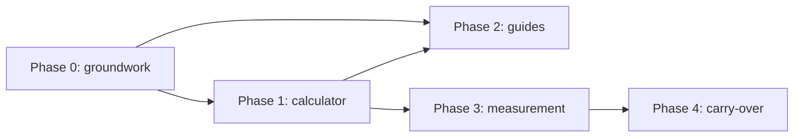

# Magnet pages build plan (web)

Written 2026-10-13. Scope: `apps/web` only. Companion to
[`website-structure.md`](./website-structure.md).

## Goal

Bring group organizers in from search and hand them to sign-up, with pages that
are useful without an account:

1. **Quota calculator** at `/tools/quota-calculator`.
2. **Three guides** at `/guides/...`, each answering one search question and
   linking to the calculator.

Success is measured in organizers who start a group after arriving on one of
these pages, not in page views.

## Out of scope

- The landing page at `/` and `/pricing`. They share the layout built in phase 0
  but are planned separately.
- `/compare/golfdogfight` and a second calculator.
- The Previous plus/minus method in the calculator; see decisions.
- Any change to quota rules, sign-up, or the portal, except the one sign-up link
  parameter in phase 3.
- Paid acquisition and social content.

## Starting point (checked 2026-10-13)

| Fact                    | Value                                                                                                                     |
| ----------------------- | ------------------------------------------------------------------------------------------------------------------------- |
| Root address            | `apps/web/src/app/page.tsx` redirects to `/sign-in`                                                                       |
| Public layout           | `InformationShell` only: one narrow card, used by help, support and legal pages                                           |
| Quota math              | `calculateQuota` in `src/domain/quota-rules.ts`; pure, no server imports, so it can run in the browser                    |
| Quota methods           | Moving average (4 to 20 rounds, default 10), Best 10 of 20, Previous plus/minus (adjustment bands)                        |
| Route gating            | None in `src/proxy.ts`; pages are public unless they check sign-in themselves                                             |
| Search files            | No `robots` or `sitemap` route exists                                                                                     |
| Page metadata           | One site-wide title and description in `src/app/layout.tsx`                                                               |
| Content security policy | `script-src 'self' 'unsafe-inline'`; a third-party analytics script would need a policy change                            |
| Guards                  | `tests/user-facing-copy.test.ts`, `tests/web-styling-guard.test.ts`, `tests/web-accessibility-skip-link.test.ts`          |
| Framework               | Next.js 16.2.11; `apps/web/AGENTS.md` requires reading `node_modules/next/dist/docs/` before using any routing or SEO API |

## Decisions

- **The calculator uses the product's own math.** It imports `calculateQuota`
  and adds no second implementation. A golfer who later joins a group sees the
  same number in the app.
- **Magnet pages are static.** They read no cookies and call no database, so they
  can be cached and stay up during an Auth outage. The header always shows "Sign
  in"; it does not check who is signed in.
- **Guides are plain TSX pages using `Prose`.** Three pages do not justify an MDX
  dependency. Revisit if the count passes about ten.
- **No new CSS files, no new primitives unless needed.** Pages are built from
  `src/components/ui/` and `src/components/blocks.tsx`, per `apps/web/AGENTS.md`.
- **Copy is a separate pass** at the end of each phase, per the root `AGENTS.md`.
- **"Dogfight" does not appear in on-screen text** (owner, 2026-10-13). That rules
  out a guide built on that search term; the third guide covers running a points
  game instead. The word is also kept out of addresses, titles and descriptions.
- **The calculator ships with two methods: Moving average and Best 10 of 20.**
  Previous plus/minus needs an example set of adjustment bands, and no real set
  is on hand. It is added when a group's actual bands are available; the plan
  does not invent one.
- **The sign-up source is stored as a nullable text column on `public.groups`.**
  A group has one origin, so a separate table adds nothing. Revisit only if more
  than one source per group ever needs recording.

## Phase 0: shared groundwork

Everything the magnet pages need that does not exist yet.

1. Read the Next.js 16 docs for route groups, the Metadata API, `sitemap` and
   `robots` in `apps/web/node_modules/next/dist/docs/01-app/`.
2. Add a route group `src/app/(marketing)/` with its own `layout.tsx`. Route
   groups do not change addresses.
3. Build `MarketingShell` beside `InformationShell`: brand link, links to the
   calculator and guides, "Sign in", and a "Start a group" button to `/sign-up`.
   Reuse `SkipLink`, `BrandMark` and `InformationFooter`; add the calculator and
   guides to the footer links.
4. Set `metadataBase` in `src/app/layout.tsx` from `webRuntimeEnv.appUrl`.
5. Add `src/app/robots.ts` and `src/app/sitemap.ts`. The sitemap lists only
   marketing pages plus help and legal pages.
6. Mark `/portal`, `/member`, `/scoreboard`, `/account`, `/home`, and the
   sign-in and recovery pages as not for indexing through their layout or page
   metadata.

Done when:

- A placeholder page under `(marketing)` renders with the new shell at phone and
  desktop widths.
- `/robots.txt` and `/sitemap.xml` respond, and the sitemap contains no app
  address.
- `pnpm check` passes, including the three guard tests.

## Phase 1: quota calculator

Files:

- `src/app/(marketing)/tools/quota-calculator/page.tsx`: static page with its
  own title and description, a short explanation above the form, and links to
  the guides below it.
- `src/app/(marketing)/tools/quota-calculator/quota-calculator.tsx`: client
  component holding the form and result.
- `src/domain/quota-calculator-input.ts`: pure helper that turns form values into
  the input `calculateQuota` expects, so it can be unit tested.
- `tests/quota-calculator-input.test.ts`.

Form:

| Field                  | Shown for              | Notes                                                                 |
| ---------------------- | ---------------------- | --------------------------------------------------------------------- |
| Method                 | Always                 | Native select; labels match the portal: Moving average, Best 10 of 20 |
| Rounds counted         | Moving average         | Whole number, 4 to 20, default 10                                     |
| Points from each round | Both methods           | Up to 20 values, oldest first, with "Add a round" and remove controls |
| Starting quota         | Both methods, optional | Used when there are too few rounds                                    |

Result:

- The new quota, in large figures.
- Which rounds counted toward it (from `sourcePointTotals`).
- One worked line, for example what a given score next round means against the
  new quota.
- A single next step: a button to `/sign-up?from=quota-calculator` with a label
  along the lines of "Keep quotas for your whole group".

Behavior:

1. Calculate in the browser on submit; no request leaves the page.
2. Show the messages `calculateQuota` throws through `FieldError`. They are
   already written for people.
3. When there are too few rounds and no starting quota, ask for a starting quota
   in plain words; do not show an error.
4. Keep the entered values in the address query so a golfer can share a result.
   Drop this step if it adds more than a little work.

Done when:

- Both methods return the same quota as the portal for the same inputs, proven
  by tests that run both through `calculateQuota`.
- The form is usable by keyboard and at phone width, with 44px controls.
- The page has its own title, description and one `h1`.
- Copy pass complete; `pnpm check` passes.

## Phase 2: guides

Files:

- `src/app/(marketing)/guides/page.tsx`: index listing the guides.
- `src/app/(marketing)/guides/quota-game-rules/page.tsx`
- `src/app/(marketing)/guides/how-to-calculate-a-golf-quota/page.tsx`
- `src/app/(marketing)/guides/how-to-run-a-golf-points-game/page.tsx`

Each guide follows one shape:

1. The question as the `h1`, and the answer in the first paragraph.
2. A worked example with real numbers.
3. The variations groups use, each in a short section.
4. A link into the calculator at the point where the reader would want to try
   it, and the "Start a group" button at the end.
5. Links to the other two guides.

| Guide                         | Question it answers                              | Links to the calculator with                 |
| ----------------------------- | ------------------------------------------------ | -------------------------------------------- |
| Quota game rules              | How does a quota game work?                      | Default method                               |
| How to calculate a golf quota | How do I work out a player's quota?              | Each of the two methods, one link per method |
| How to run a golf points game | How do I run a regular points game for my group? | Default method                               |

Content rules:

- Golf facts come from the owner or a cited source. Point values and payout
  customs vary by group, so each guide says so and never presents one group's
  rules as the standard.
- No invented numbers. Examples use round figures and are labeled as examples.
- The guard test bans some words in on-screen text; guides are covered by it.

Done when:

- All three guides and the index are in the sitemap.
- Each guide has its own title and description and exactly one `h1`.
- The owner has read each guide for golf accuracy.
- Copy pass complete; `pnpm check` passes.

## Phase 3: measurement

1. Read `from` on `/sign-up` and keep it through the verification e-mail to
   `/sign-up/finish`, then store it in a new nullable text column on
   `public.groups`. This is a migration and needs a pgTAP test.
   Done 2026-10-15: `groups.signup_source` holds `quota-calculator` or the
   guide's slug; the guides' "Start a group" buttons are tagged too.
2. Verify the site in Google Search Console once the domain is settled, and
   submit the sitemap.
3. Review after four weeks of search data: which guide brings visitors, how many
   reach the calculator, how many start a group.

Done when a group created from the calculator's button can be told apart from
one created from a direct visit.

## Phase 4: carry the numbers into sign-up (later)

The structure document says sign-up opens with the calculator's numbers carried
over. That is harder than it sounds: sign-up passes through e-mail verification,
and there is no member to attach point totals to until the group exists.

A workable version:

1. Carry only the method and the rounds counted, and pre-select them on the
   group's quota settings.
2. Hold them in the browser across verification, since the verification link
   usually opens in the same browser.
3. Fall back to the normal defaults when nothing is found.

Build this only if phase 3 shows that organizers arrive from the calculator.

## Order and dependencies

Phase 2 follows phase 1 because every guide links to the calculator. The landing
page can be built alongside phase 1 once phase 0 is in.

## Open questions

1. **Domain.** The sitemap, `metadataBase` and Search Console all depend on the
   final address. Phases 0 to 2 can ship on any address; phase 3 step 2 cannot.
2. **Analytics beyond sign-up source.** Counting visits to the calculator needs
   either a first-party counter or a policy change to allow a third-party
   script. Search Console covers search visits without either.
