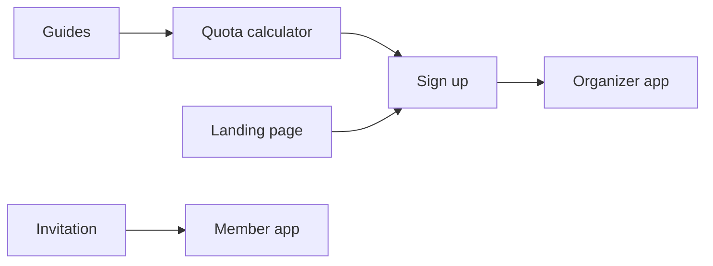

# GreenRoster website structure

Date: October 13, 2026  
Status: plan; nothing here is built yet

## Decision

GreenRoster is one site on one domain: public pages at the top level, the app
behind sign-in underneath. Today the root address redirects to sign-in, so there
is no public site yet. This plan adds one without moving any existing address.

The public site has two jobs. The landing page sells the product to group
organizers. The free quota calculator and the guides bring organizers in from
search and hand them to sign-up.

## Site map

```
/                             Landing page for organizers
/pricing

/tools                        Free calculators, no sign-in
  /quota-calculator
  /points-calculator          later, if the first earns traffic

/guides                       Search content
  /quota-game-rules
  /how-to-calculate-a-golf-quota
  /how-to-run-a-golf-points-game

/compare
  /golfdogfight               For groups looking to switch

/help, /support, /privacy, /terms        (exist)
/sign-in, /sign-up, /invitations/...     (exist)

App, behind sign-in                      (exists)
  /portal/...                 organizer
  /member/...                 member
  /scoreboard/...             clubhouse screen
```

| Address                                    | What it is                                | Who it is for                   | Status                            |
| ------------------------------------------ | ----------------------------------------- | ------------------------------- | --------------------------------- |
| `/`                                        | Landing page                              | Organizers                      | Built 2026-10-18                  |
| `/pricing`                                 | Pricing                                   | Organizers                      | New                               |
| `/tools/quota-calculator`                  | Free quota calculator, no sign-in         | Organizers arriving from search | New                               |
| `/tools/points-calculator`                 | Second calculator                         | Organizers arriving from search | Later, if the first earns traffic |
| `/guides/quota-game-rules`                 | Guide                                     | Organizers arriving from search | New                               |
| `/guides/how-to-calculate-a-golf-quota`    | Guide                                     | Organizers arriving from search | New                               |
| `/guides/how-to-run-a-golf-points-game`    | Guide                                     | Organizers arriving from search | New                               |
| `/compare/golfdogfight`                    | Comparison page                           | Groups looking to switch        | New                               |
| `/help`, `/support`, `/privacy`, `/terms`  | Help and legal pages                      | Everyone                        | Exists                            |
| `/sign-in`, `/sign-up`, `/invitations/...` | Sign-in, sign-up, accepting an invitation | Organizers and members          | Exists                            |
| `/portal/...`                              | Organizer app                             | Organizers                      | Exists                            |
| `/member/...`                              | Member app                                | Members                         | Exists                            |
| `/scoreboard/...`                          | Clubhouse screen                          | The group, on a shared screen   | Exists                            |

## How the pieces connect

Every public page leads one step closer to an organizer starting a group.



1. **Guides feed the calculator.** Each guide answers one search question and
   ends by sending the reader to the calculator.
2. **The calculator feeds sign-up.** It works fully without an account. After
   the result it offers one next step, keeping quotas for the whole group, which
   opens sign-up with the numbers already entered carried over.
3. **The landing page speaks to organizers only.** Members arrive through
   invitations and never need it.
4. **Signed-in visitors skip the landing page.** The root address sends them
   straight to their group.

## Why one domain

A separate app address such as `app.greenroster.com` was considered and rejected
for now.

- **Search strength stays in one place.** Links earned by the calculator and the
  guides lift the whole site, including the landing page.
- **No extra plumbing.** The product is already one Next.js app. A split adds
  sign-in and cookie handling across two addresses for no gain at this size.
- **One address to say aloud.** An organizer tells a member to go to the site,
  and the same address works for both of them.

## Build details

- **Two layouts in the same app.** Public pages get a marketing header with
  "Sign in" and "Start a group". App pages keep the existing portal shell.
  Next.js route groups do this without changing any address.
- **Search engines stay out of the app.** Only public pages go in the sitemap.
  `/portal`, `/member` and `/scoreboard` are marked as not for indexing.
- **Root address behavior.** Signed-out visitors see the landing page. Signed-in
  visitors are redirected to their group, replacing today's redirect to
  `/sign-in` in `apps/web/src/app/page.tsx`.
- **Name clash to avoid.** The app already has a `/home` route. The landing page
  lives at `/`, and no public "home" address is added.
- **Domain.** The exact-match .com is listed for sale and not yet bought.
  `greenrostergolf.com` is the fallback until it is.

## Build order

1. Landing page at `/` and the calculator at `/tools/quota-calculator`.
2. Two or three guides, each linking to the calculator.
3. `/compare/golfdogfight` and `/pricing`.
4. A second calculator, only if the first one earns search traffic.
